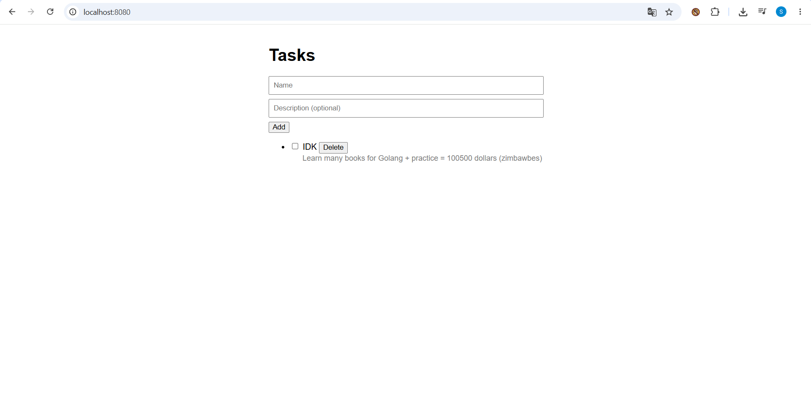

# ToDoList V0

[Русская версия](README.ru.md)

A simple to-do list: a REST-style JSON API written in Go (standard library only) with a small HTML + vanilla JS frontend.

My first pet project, so it is a work in progress. 🚧



## Features

- Add a task with a title and an optional description
- Mark a task as done / not done
- Delete a task

## Run

Requires Go 1.22+ (uses the method + path routing patterns of the standard `net/http`).

```
go run ./cmd/main.go
```

Then open http://127.0.0.1:8080 in your browser.

## API

CRUD over JSON:

| Method | Path          | Body                                | Description        |
|--------|---------------|-------------------------------------|--------------------|
| GET    | `/tasks`      | -                                   | List all tasks     |
| POST   | `/tasks`      | `{"title": "...", "message": "..."}`| Create a task     |
| PATCH  | `/tasks/{id}` | `{"status": true}`                  | Update task status |
| DELETE | `/tasks/{id}` | -                                   | Delete a task      |

## Notes

- Tasks are stored in a slice and json file
- A mutex protects the slice from concurrent access.
- The server listens on localhost only. There is no authentication, no HTTPS and only minimal validation. This is a learning project.

## Roadmap

- [+] Persistent storage (JSON file)
- [+] Server-side validation, request size limit, server timeouts
- [ ] Tests
- [ ] Postgress